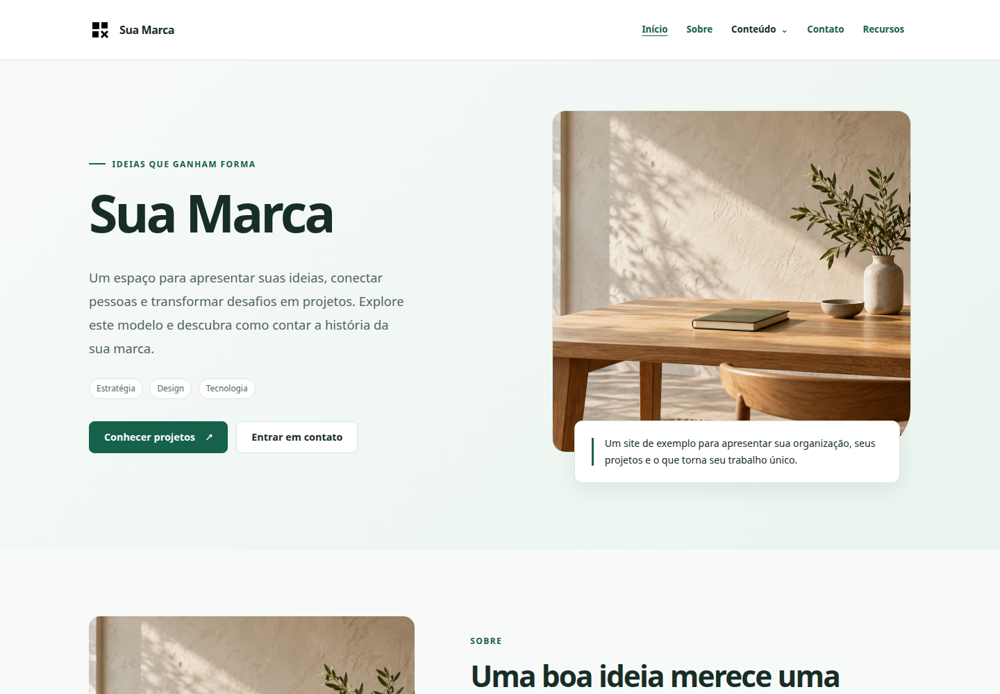

# dbless-cms

**Seu conteúdo. Seu código. Nenhum banco de dados para gerenciar.**

Crie sites bem apresentados com um CMS PHP focado, conteúdo JSON legível e um painel
administrativo responsivo. Comece com um site de exemplo completo, adapte-o à sua marca
e amplie-o com templates e plugins adequados aos seus projetos.



[Comece agora](#comece-agora) · [Crie um template](docs/templates.md) · [Crie um plugin](docs/plugins.md) · [Read in English](README.md)

## Uma base prática para seu próximo site

- **Dispense o provisionamento de banco de dados.** Páginas, menus, slides e configurações
  ficam em arquivos JSON estruturados. Simplifique a hospedagem e facilite a inspeção e a
  transferência do conteúdo.
- **Ofereça um ambiente próprio para editores.** Gerencie páginas, rascunhos, revisões,
  lixeira, menus, mídia e slides em um painel responsivo, independente do tema público.
- **Controle a apresentação.** Templates recebem conteúdo validado e controlam seu HTML,
  CSS e JavaScript. Adicione seu design sem adotar um framework de frontend.
- **Amplie conforme a necessidade.** Plugins declaram rotas, navegação, dicionários e
  configurações. Rotas administrativas privadas e rotas públicas possuem contratos distintos.
- **Comece com algo útil.** O Essencial oferece paletas, tema escuro, tipografia, orientação
  do texto e exemplos de todos os plugins incluídos.
- **Conte com proteções explícitas.** O CMS inclui proteção de sessão/CSRF, contratos de
  entrada, verificação de revisões, exclusão recuperável e armazenamento privado de conteúdo.

Escolha o dbless-cms para sites institucionais, portfólios, landing pages e projetos de
conteúdo nos quais um CMS baseado em arquivos seja adequado. PHP 8.2+ executa a aplicação;
Node.js 22 é uma ferramenta de desenvolvimento/exportação, sem dependência no servidor de produção.

## Explore um exemplo completo

A distribuição inclui o template **Essencial** e quatro plugins prontos para uso:

| Plugin | O que oferece ao seu projeto |
| --- | --- |
| Pages | Páginas estruturadas, rascunhos, publicação, histórico e lixeira |
| Menu | Navegação hierárquica associada aos locais declarados pelo template |
| Slides | Banners, carrosséis, testemunhos, produtos e conteúdo rotativo |
| Files Manager | Uploads públicos/privados, pastas, visualização e exclusão recuperável |

O site de exemplo conecta páginas, menus e slides para permitir aprendizado a partir
de um site funcional. Suas três imagens originais estão incluídas sob Apache-2.0.
O painel oferece inglês e português brasileiro; o conteúdo editorial de exemplo está
em português brasileiro e pode ser editado independentemente do idioma do painel.

## Comece agora

Requer PHP 8.2+ com JSON, sessões, fileinfo, OpenSSL e Argon2id, além de Node.js 22 para
os comandos de desenvolvimento.

```bash
git clone https://github.com/jepasa/dbless-cms.git
cd dbless-cms
npm ci --ignore-scripts
cp .env.example .env
```

Defina o administrador de desenvolvimento no `.env`: escolha um usuário e uma senha
exclusiva de pelo menos 16 caracteres em `DBLESS_CMS_ADMIN_USER` e `DBLESS_CMS_ADMIN_PASSWORD`.
Esses nomes de variáveis de compatibilidade são intencionais. Nenhuma senha funcional é fornecida.

```bash
npm run dev
```

Acesse **http://127.0.0.1:8080/** e **http://127.0.0.1:8080/cms-admin/**.
O conteúdo inicial é instalado uma única vez; o conteúdo existente é preservado.
O desenvolvimento executa diretamente de `src/`. Para produção, siga a seção de publicação
do [guia de templates](docs/templates.md#10-deploy-a-site-with-your-template): são necessários HTTPS,
configuração privada com hash de senha e exportação explícita. Pacotes de produção ignoram `.env`.

## Adapte ao seu projeto

- [Utilize e desenvolva templates](docs/templates.md): instalação, manifestos, contratos
  de conteúdo, opções de tema, locais de menus/slides, recursos e publicação.
- [Utilize e desenvolva plugins](docs/plugins.md): instalação, rotas privadas/públicas,
  interface administrativa integrada, dicionários, configurações e persistência segura.

Execute `npm run verify` antes de propor alterações. O repositório inclui fluxos de
qualidade e segurança; comunique vulnerabilidades pela [política de segurança](SECURITY.md).

## Ajude outros desenvolvedores a descobrir um CMS mais simples

Se o dbless-cms combina com seu próximo projeto, **[deixe uma estrela no repositório](https://github.com/jepasa/dbless-cms)**.
Uma estrela ajuda outras pessoas a descobrir o projeto e sinaliza interesse em sua continuidade.
Experimente os exemplos, crie um template, compartilhe um plugin ou relate um problema
reproduzível—sua experiência pode ajudar a construir uma ferramenta mais útil.

## Licença

**Apache-2.0**: utilize, modifique e distribua o dbless-cms, inclusive em projetos comerciais,
respeitando os termos da licença. Preserve os avisos aplicáveis. Componentes de terceiros
mantêm suas próprias licenças. Consulte [LICENSE](LICENSE), [NOTICE](NOTICE) e [THIRD_PARTY.md](THIRD_PARTY.md).
